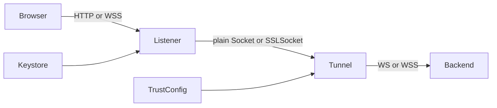

# Requirements

### Overview & Goals
Extend the existing raw-socket proxy so it supports secure WebSockets on both hops: browsers may connect with `wss://`, and the proxy may connect to a TLS-enabled backend container. Existing `http://`, `ws://`, SSE, query forwarding, and bidirectional WebSocket behavior must continue to work.

### Scope
#### In scope
- Add configurable TLS termination for the browser-facing listener.
- Add configurable TLS for the proxy-to-backend connection.
- Preserve plain HTTP/WS operation and make the secure modes explicit through configuration.
- Configure the browser-facing certificate using a PKCS12/JKS keystore path and password supplied through startup configuration.
- Add integration coverage for secure WebSocket handshakes and message forwarding, plus regression coverage for existing protocols.

#### Out of scope
- Automatic certificate issuance or renewal.
- Implementing WebSocket framing or message translation; the proxy continues forwarding bytes transparently.
- Replacing the proxy with an external reverse proxy.

### Acceptance Criteria
- A browser can connect to the proxy using `wss://.../.ws` when TLS listener configuration and a valid keystore are supplied.
- The proxy can connect to a backend using `wss://`/TLS while forwarding the handshake and frames unchanged.
- Plain `ws://` and HTTP/SSE modes still function when TLS is disabled.
- Invalid or unreachable TLS targets produce a controlled `502 Bad Gateway`, and TLS configuration errors fail clearly at startup.

# Technical Design

### Current Implementation
`WebUiProxy` in `src/main/java/nbgsmk/msr/NativeWebServer.java` uses a plain `ServerSocket` in `start()` (lines 28–53), accepts connections in `acceptLoop()` (lines 55–65), opens a plain outbound `Socket` in `handleConnection()` (lines 67–106), and copies both directions in `pipeStreams()` (lines 108–130). This correctly preserves HTTP, SSE, and WebSocket bytes but provides no TLS negotiation. `main()` (lines 145–162) currently accepts only listen port, target host, and target port.

### Key Decisions
- Keep the transparent byte tunnel rather than parsing WebSocket frames; TLS is handled by socket wrappers before the existing piping logic.
- Model the two TLS hops independently: a server-side `SSLServerSocket`/`SSLSocket` for browser-to-proxy TLS and an `SSLSocket` created from an `SSLContext` for proxy-to-backend TLS.
- Preserve plain sockets as the default to avoid breaking existing invocations.
- Load the browser certificate from a configured keystore and build a server `SSLContext`; use a configurable trust strategy for backend TLS, defaulting to normal certificate validation with an explicit local-testing option only if needed.

### Proposed Changes
- Extend `WebUiProxy` configuration with listener TLS settings, backend TLS settings, keystore/truststore locations, passwords, and any certificate-validation mode required by the chosen startup contract.
- Replace hard-coded `new ServerSocket(...)` and `new Socket(...)` creation with small socket-factory methods that select plain or TLS sockets per hop.
- Ensure TLS handshakes are completed before the two virtual-thread piping tasks begin, so handshake failures are handled as connection errors rather than corrupting the tunnel.
- Update startup parsing and console diagnostics in `NativeWebServer.main()` to expose the secure modes without changing the existing positional defaults; update the advertised endpoint from `ws://` to the appropriate scheme when listener TLS is enabled.
- Keep `pipeStreams()`, shutdown handling, and the existing `502` path compatible with both `Socket` and `SSLSocket` instances.
- Use `src/main/resources/application.properties` only if configuration is moved into Spring-managed properties; otherwise keep this standalone `Main`/`WebUiProxy` entry point and document command-line/environment configuration.

### Architecture Diagram

### File Structure
- Modify `src/main/java/nbgsmk/msr/NativeWebServer.java` for TLS configuration, socket creation, startup parsing, and diagnostics.
- Keep `src/main/java/nbgsmk/msr/Main.java` as the delegating entry point unless argument/configuration handling requires a narrowly scoped update.
- Extend `src/test/java/nbgsmk/msr/NativeWebServerTest.java` with secure listener/backend scenarios and plain-mode regressions.
- Update `src/main/resources/application.properties` or project documentation only if the final configuration contract uses those resources.

### Risks
- A browser will reject a self-signed certificate unless the test certificate is trusted; tests should use a generated keystore and an explicitly configured client trust context.
- Backend hostname verification and trust-store requirements can make local container testing fail unexpectedly; expose these settings clearly and avoid silently disabling validation in production-like mode.
- TLS handshake failures occur before byte piping and must not be mistaken for backend application errors.

# Testing

### Validation Approach
Run the existing Gradle JUnit suite with Java 21 and add integration coverage using local loopback sockets and an in-process TLS test endpoint, avoiding dependence on an externally running container for secure-mode tests.

### Key Scenarios
- Plain HTTP GET, query parameters, SSE streaming, and `ws://` handshake/message forwarding remain successful.
- Browser-facing TLS accepts a trusted `wss://` client and forwards the WebSocket handshake and frames to a plain backend.
- Browser-facing TLS accepts a `wss://` client while the backend leg is also TLS-enabled.
- Plain browser-side WebSocket traffic is forwarded to a TLS backend when that mode is selected.
- Invalid keystore configuration fails at startup with a useful error.
- Unreachable or failed TLS backend returns `502 Bad Gateway` without hanging the client.

### Edge Cases
- Verify clean shutdown closes TLS and plain sockets and virtual-thread tasks.
- Verify query strings, upgrade headers, and WebSocket binary/text frame bytes are not modified.
- Verify certificate/trust configuration is not logged with passwords or private key material.

# Delivery Steps

###   Step 1: Define TLS configuration and socket factories
`WebUiProxy` has explicit independent TLS settings for its listener and backend connection.
- Add a configuration model or constructor parameters for listener TLS, backend TLS, keystore/truststore paths, passwords, and validation behavior.
- Build server and client `SSLContext` instances from the configured stores.
- Replace direct `ServerSocket`/`Socket` construction with factories that choose plain or TLS sockets while retaining the existing defaults.
- Update startup arguments and diagnostics in `NativeWebServer.main()` and preserve `Main.java` delegation.

###   Step 2: Integrate secure sockets into the tunnel
The existing transparent forwarding path supports TLS sockets on either hop without changing WebSocket payload bytes.
- Complete TLS handshakes before starting the two virtual-thread pipe tasks.
- Preserve half-close and cleanup behavior for `SSLSocket` and plain `Socket` instances.
- Keep HTTP, SSE, WS, and existing backend error handling compatible with the new socket selection.
- Advertise `wss://` for the browser-facing endpoint when listener TLS is enabled.

###   Step 3: Add secure proxy integration coverage
The test suite verifies WSS on both hops and protects all previously supported proxy protocols.
- Extend `NativeWebServerTest.java` with generated/test keystore material and trusted TLS client/server contexts.
- Test browser-to-proxy WSS with a plain backend and with a TLS backend.
- Test backend TLS connection establishment, frame echo/forwarding, certificate failures, and `502` handling.
- Retain regression checks for HTTP, query forwarding, SSE, plain WS, and shutdown behavior, then run the Java 21 Gradle test suite.